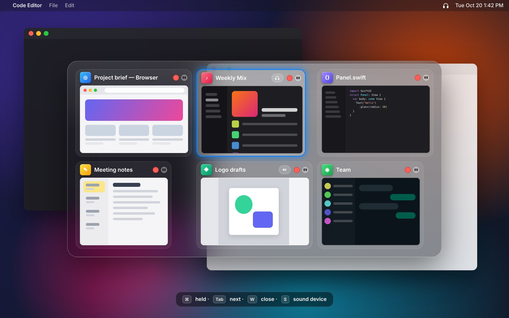
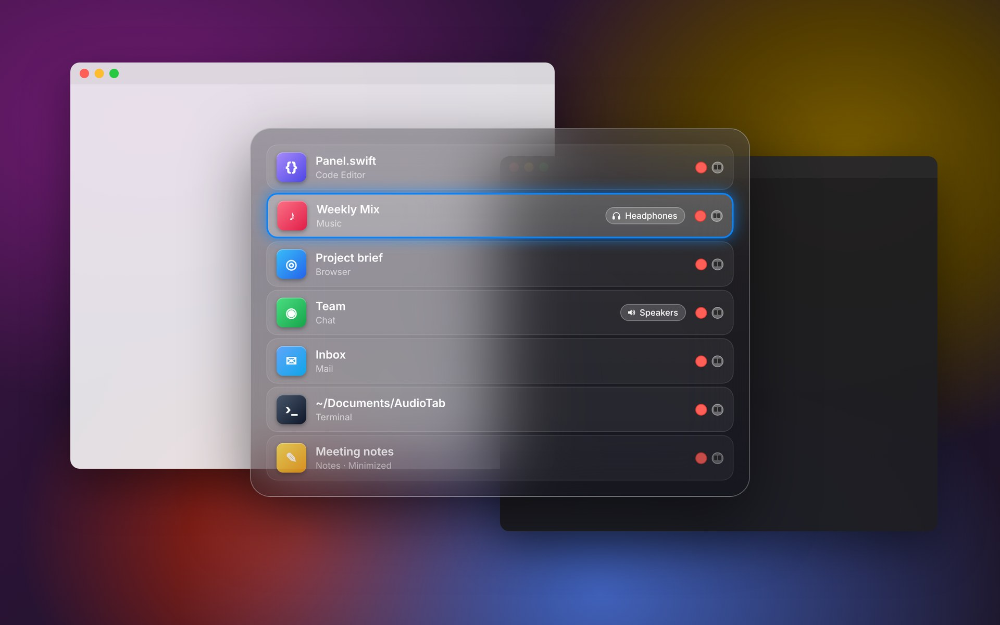
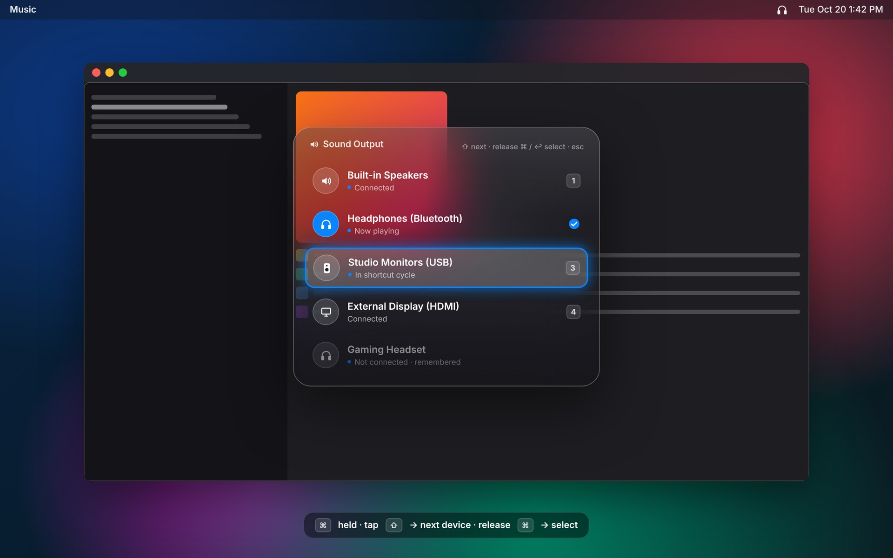

<div align="center">

# AudioTab

**One tiny app in your Mac's menu bar:**<br>
a glass ⌘Tab · one-key sound output switching · window tiling · screenshots and MP4 recording

[**Download**](https://github.com/debelemez/AudioTab/releases/latest) · [Install](#install) · [Shortcuts](#all-shortcuts) · [**Türkçe**](README.tr.md)



<sub>Images illustrate the app's interface.</sub>

</div>

---

## What it does

| | |
|---|---|
| **⌘Tab, window by window** | You see windows, not just apps, with big previews. Every Chrome profile window and every window on other Spaces is included. Close a window with the red dot on its card, or move it to part of the screen with the button next to it. |
| **One-key sound output** | Hold ⌘ and tap ⇧: headphones → speakers → monitor. It remembers headphones you unplug and puts them back in the list when you plug them in. Works with eqMac. |
| **Sound per app** | Music on the speakers, meetings on the headphones. When an app comes to the front, sound switches to its device automatically. |
| **Split screen (⌘<)** | Choose how to split the screen, then which window goes where. With two or three displays it knows which one you're on, or asks. |
| **Screenshots and recording** | ⌘⇧3 captures only the display you're on. Scrolling screenshots for long pages. ⌘⇧5 records the screen as **MP4 / H.264**, with a recording indicator only you can see. |
| **Updates itself** | When a new version is out, the menu shows "Update available". One click to update; settings and permissions are kept. |

It does nothing while idle: no timers, no background polling. It only goes online to check for updates. Native Swift, not Electron.

---

## ⌘Tab window switcher



- **Grid** view with big previews, or **List** view. Set separately for ⌘Tab and ⌥Tab.
- The selected card stands out with an accent-colored border.
- The **red dot** at the top right of a card closes the window. The **split button** next to it moves the window to part of the screen.
- If you've assigned a sound device to an app, it shows as a small badge on the card. Change it with **S** while the panel is open.
- **Every window** of your browsers is always listed: Chrome, Safari, Arc, Brave, Edge, Firefox and more. That includes other profiles, other Spaces and full-screen windows.
- Click an empty spot to close the panel.

## Sound output: ⌘⇧



- **Hold ⌘ and tap ⇧.** It either switches straight to the next device or opens this panel. Tap ⇧ again to move down, release ⌘ to select (just like ⌘Tab).
- You choose which devices are in the cycle and which appear in the list.
- Unplugged devices stay as "Not connected · remembered". Plug them back in and their settings return.
- It doesn't interfere with shortcuts like ⌘⇧4 or ⌘⇧Z: if another key is pressed in between, it doesn't fire. ⌘ + Caps Lock is available as an alternative.

## Split screen: ⌘<


1. Press **⌘<**. This is the key next to the left ⇧ on ISO keyboards, such as Turkish and German.
2. Choose a layout: full, 2 columns, 2 rows, 3 columns, ⅓+⅔, ⅔+⅓, ½+¼¼, 2×2, 3×2.
3. Zones light up one by one. Pick a window for each from the list, with the keyboard or the mouse.

With several displays, a big number appears on each screen. The target is the display under the mouse. Change it with **Tab**, or set it to ask every time.

## Screenshots and recording


| Shortcut | What it does |
|---|---|
| **⌘⇧3** | Captures **only the display you're on** |
| **⌘⇧4** | Area selection (the macOS picker; Space for a window) |
| **⌘⇧6** | **Scrolling screenshot**: select an area, the page scrolls by itself and becomes one long PNG. Sticky headers aren't repeated. |
| **⌘⇧5** | Capture palette: display · area · scrolling · **record display** · **record area** |

- Video is recorded as **MP4 / H.264**, at 30 or 60 fps. There are "High" and "Maximum" quality options; system audio and the cursor are optional.
- While recording, a **red dot and timer** appear at the top right. Only you can see it; it isn't recorded. Click it to stop.
- After a capture, a **preview** appears at the bottom right. Click it to open the file selected in Finder.
- You can pick a separate save folder for each type. Turn everything off with one switch and the macOS shortcuts come back.

## Settings


Click the menu bar icon (it shows the current sound device) › **Settings…** (⌘,). There are five tabs:

- **Sound:** shortcut, device table, sound device per app.
- **Windows:** ⌘Tab and ⌥Tab settings, list or grid, previews, always find windows.
- **Screen:** split screen, screenshots and recording, save folders, video quality.
- **Permissions:** which permissions are granted and what each is for.
- **General:** language (English / Türkçe), launch at login, updates.

---

## Install

macOS 13 (Ventura) or later, Apple Silicon and Intel. Paste this into Terminal:

```bash
curl -fsSL https://raw.githubusercontent.com/debelemez/AudioTab/main/install.sh | bash
```

Or download `AudioTab.zip` from [Releases](https://github.com/debelemez/AudioTab/releases/latest) and drag `AudioTab.app` into your **Applications** folder.

**On first launch** macOS asks for two permissions. Turn AudioTab on under System Settings › Privacy & Security:

| Permission | What for |
|---|---|
| **Accessibility** | ⌘Tab, the sound shortcut, split screen and all shortcuts |
| **Screen Recording** | Window previews, screenshots and recording |

After granting Screen Recording, quit and reopen the app once. You won't need to grant permissions again after updates.

The app starts in English. To switch to Turkish, go to Settings › General › Language and choose Türkçe.

<details>
<summary><b>The app won't open: "developer cannot be verified"</b></summary>

AudioTab is free and isn't enrolled in Apple's paid developer program. If you install with `install.sh`, you won't see this warning. If you downloaded the zip in a browser, do this once: try to open AudioTab, then click **Open Anyway** at the bottom of **System Settings › Privacy & Security**. Or run `xattr -dr com.apple.quarantine /Applications/AudioTab.app` in Terminal.
</details>

<details>
<summary><b>I was using GlassTab or AudioHop</b></summary>

AudioTab combines both, and your settings carry over automatically on first launch. Quit the old apps and move them to the Trash so they don't try to grab the same shortcuts. The Input Monitoring permission the old AudioHop needed is no longer required.
</details>

---

## All shortcuts

| Shortcut | Action |
|---|---|
| **⌘Tab** / **⌥Tab** | Window switcher (Tab forward, ⇧Tab back, release ⌘ to switch) |
| **W · M · H · Q** in ⌘Tab | Close · Minimize · Hide · Quit |
| **S** in ⌘Tab | Change the app's sound device |
| **Hold ⌘, tap ⇧** | Sound output (next device or list) |
| **⌘<** | Split screen |
| **⌘⇧3** | Screenshot of the display you're on |
| **⌘⇧4** | Area screenshot |
| **⌘⇧5** | Capture palette / stop recording |
| **⌘⇧6** | Scrolling screenshot |

Each shortcut can be turned off in Settings; when it's off, the macOS shortcut comes back.

## Privacy

- No usage data is collected and nothing is sent anywhere. The app only goes online to check GitHub for a new version, and you can turn that off.
- Window previews are taken only while ⌘Tab is held, one frame per window, and are never written to disk.
- The code is fully open: see the [Sources](Sources) folder for what it does.
- Security: releases are signed and the updater only installs builds signed with our certificate. The code was audited in October 2026 with no vulnerabilities found. See [SECURITY.md](SECURITY.md) and the [audit report](docs/security-audit.md).

---

## Developer notes

<details>
<summary>Building from source, releasing, signing</summary>

**Build** (requires Xcode or the Command Line Tools):

```bash
./build.sh --install          # build for this Mac and install
./build.sh --universal        # Apple Silicon + Intel
```

**New release:** bump the number in `VERSION` and push to `main`:

```bash
echo 2.4.0 > VERSION
git commit -am "2.4.0" && git push
```

GitHub Actions builds on a Mac, signs, and puts `AudioTab.zip` on Releases. Installed apps see the new version within 6 hours, or right away with "Check Now".

**Signing:** Every release is signed with the same certificate. The public certificate is in `signing/AudioTab.pem`; the private key is in the repository secrets (`CERT_P12`, `CERT_PASSWORD`). macOS ties permissions to the signature, so they're kept across updates. The updater only installs versions signed with this certificate.

**Localization:** UI strings are written in Turkish in the code and wrapped with `L("…")`. English translations are in `Sources/Localization.swift`.

**Layout:** `Switcher.swift` (⌘Tab), `AudioKeys.swift` + `DeviceStore.swift` + `CoreAudioHelper.swift` (sound), `Tiling.swift` (split screen), `Capture.swift` (screenshots and recording), `Updater.swift` (updates), `Settings.swift`, `App.swift`. All shortcuts share a single event tap.
</details>
