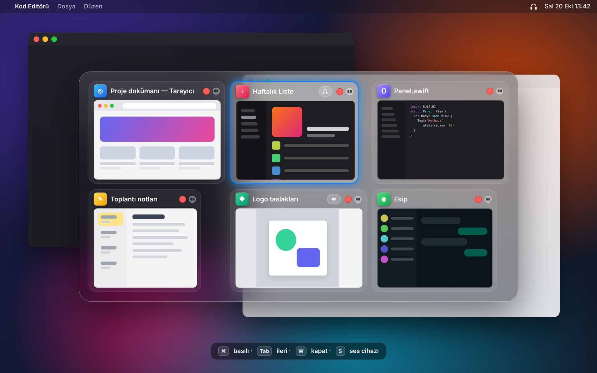
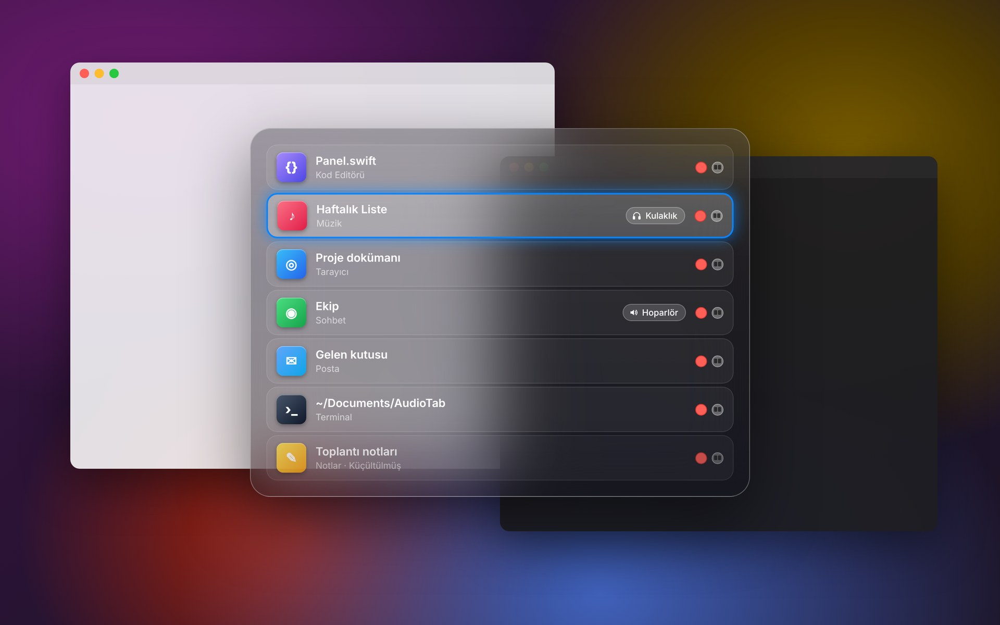
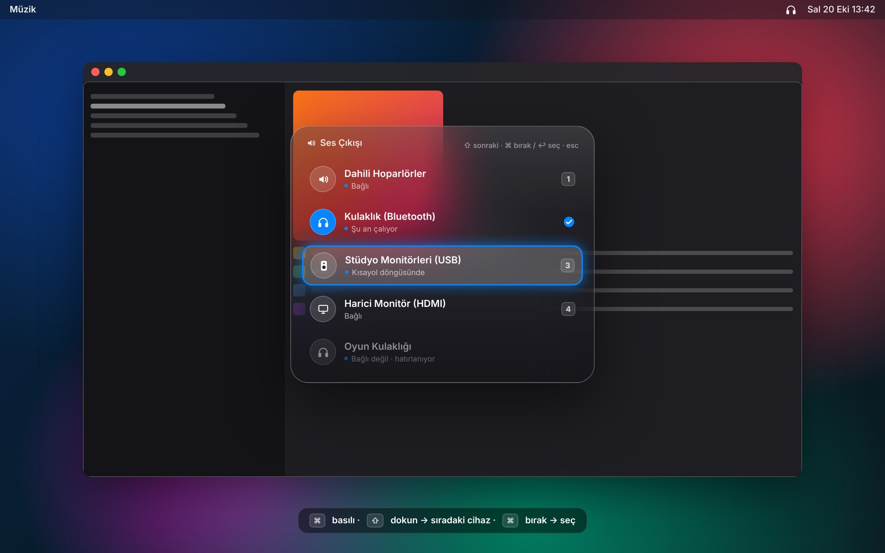
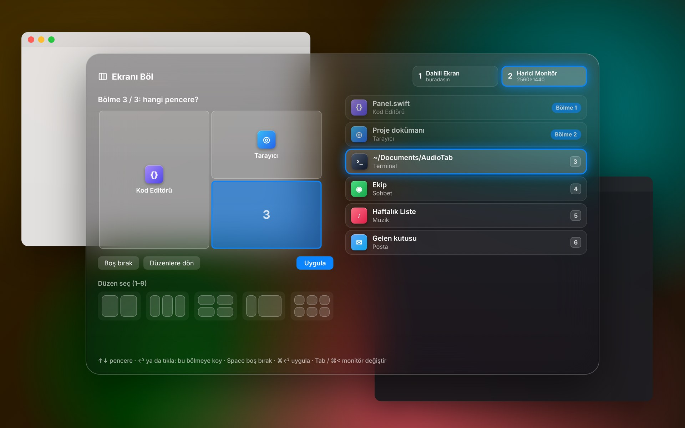
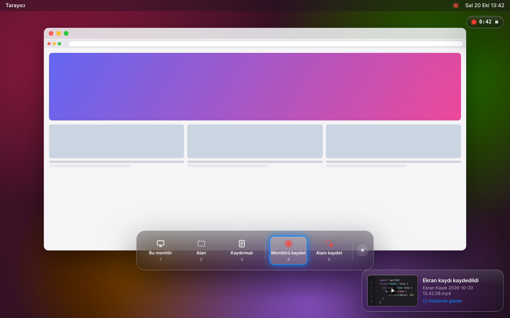
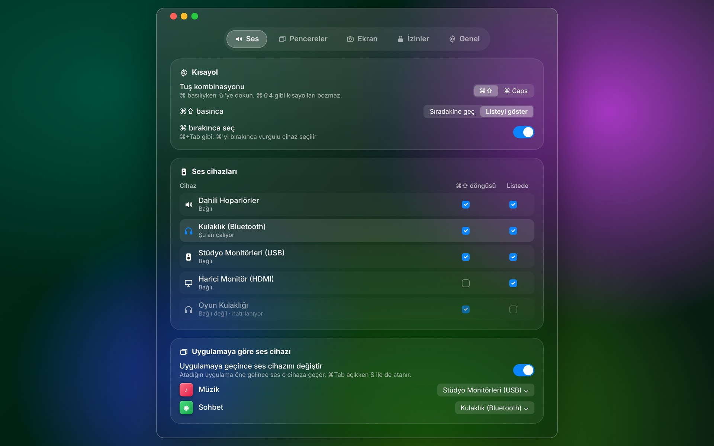

<div align="center">

# AudioTab

**Mac'in menü çubuğunda duran tek bir küçük uygulama:**<br>
cam görünümlü ⌘Tab · tek tuşla ses çıkışı · ekran bölme · ekran görüntüsü ve MP4 kayıt

[**İndir**](https://github.com/debelemez/AudioTab/releases/latest) · [Kurulum](#kurulum) · [Kısayollar](#tüm-kısayollar) · [**English**](README.md)



<sub>Görseller uygulamanın arayüzünü temsil eder.</sub>

</div>

---

## Neler yapıyor?

| | |
|---|---|
| **⌘Tab, ama pencere pencere** | Uygulamalar değil, pencereler görünür. Büyük önizlemeler, Chrome'un tüm profil pencereleri, diğer masaüstlerindekiler dahil. Karttaki kırmızı noktayla kapat, yanındaki düğmeyle ekranın bir bölmesine taşı. |
| **Tek tuşla ses çıkışı** | ⌘ basılıyken ⇧'ye dokun: kulaklık → hoparlör → monitör. Çıkardığın kulaklığı hatırlar; takınca yine listede. eqMac ile de çalışır. |
| **Uygulamaya göre ses** | Müzik hoparlörden, toplantı kulaklıktan. Uygulama öne gelince ses kendiliğinden doğru cihaza geçer. |
| **Ekranı böl (⌘<)** | Ekranı kaça böleceğini seç, sonra hangi pencere hangi bölmeye. Çift ve üç monitörde hangisinde olduğunu bilir ya da sorar. |
| **Ekran görüntüsü ve kayıt** | ⌘⇧3 sadece bulunduğun monitörü çeker. Kaydırmalı uzun ekran görüntüsü alır. ⌘⇧5 ile ekranı **MP4 / H.264** olarak kaydeder. Kayıt göstergesi sadece sana görünür. |
| **Kendini günceller** | Yeni sürüm çıkınca menüde "Güncelleme var" görünür. Tek tıkla güncellenir, ayarlar ve izinler korunur. |

Boştayken hiçbir şey yapmaz: timer yok, arka planda tarama yok, internete sadece güncelleme denetimi için çıkar. Native Swift, Electron değil.

---

## ⌘Tab: pencere değiştirici



- **Izgara** (büyük önizlemeler) ya da **Liste** görünümü. ⌘Tab ve ⌥Tab için ayrı ayrı ayarlanır.
- Seçili kart vurgu renginde çerçeveyle belirgin olur.
- Kartın sağ üstünde **kırmızı nokta** pencereyi kapatır, yanındaki **bölme düğmesi** pencereyi ekranın bir bölmesine taşır.
- Uygulamaya ses cihazı atadıysan kartta küçük bir rozet olarak görünür; panel açıkken **S** ile değiştirilir.
- Chrome, Safari, Arc, Brave, Edge, Firefox gibi tarayıcıların **tüm pencereleri** her zaman listede olur: başka profiller, başka masaüstleri ve tam ekrandakiler dahil.
- Boşluğa tıklayınca panel kapanır.

## Ses çıkışı: ⌘⇧



- **⌘ basılıyken ⇧'ye dokun.** Ya doğrudan sıradaki cihaza geçer ya da bu paneli açar; ⇧'ye tekrar dokundukça aşağı iner, ⌘'yi bırakınca seçer (⌘Tab gibi).
- Hangi cihazların döngüye gireceğini, hangilerinin listede görüneceğini sen seçersin.
- Çıkarılan cihazlar "bağlı değil · hatırlanıyor" olarak kalır. Tekrar takınca ayarları geri gelir.
- ⌘⇧4, ⌘⇧Z gibi kısayolları bozmaz; araya başka tuş girerse tetiklenmez. İstersen ⌘ + Caps Lock da kullanılabilir.

## Ekranı böl: ⌘<



1. **⌘<**'ye bas. Türkçe klavyede bu tuş sol ⇧'nin yanında.
2. Düzeni seç: tam, 2 dikey, 2 yatay, 3 dikey, ⅓+⅔, ⅔+⅓, ½+¼¼, 2×2, 3×2.
3. Bölmeler sırayla vurgulanır. Her biri için listeden pencereyi seç; klavye ve fare ikisi de çalışır.

Birden fazla monitörde her ekranda büyük bir numara çıkar. Hedef, farenin olduğu monitördür; **Tab** ile değiştirebilirsin ya da her seferinde sorsun diye ayarlayabilirsin.

## Ekran görüntüsü ve kayıt



| Kısayol | Ne yapar |
|---|---|
| **⌘⇧3** | Sadece **bulunduğun monitörün** görüntüsünü alır |
| **⌘⇧4** | Alan seçimi (macOS'un seçicisi, Space ile pencere) |
| **⌘⇧6** | **Kaydırmalı görüntü**: alanı seç, sayfa kendiliğinden kayar, tek uzun PNG olur. Sabit menüler tekrar etmez. |
| **⌘⇧5** | Çekim paleti: monitör · alan · kaydırmalı · **monitörü kaydet** · **alanı kaydet** |

- Video **MP4 / H.264** olarak kaydedilir, 30 ya da 60 fps. "Yüksek" ve "En yüksek" kalite seçenekleri var; sistem sesi ve imleç isteğe bağlı.
- Kayıt sırasında sağ üstte **kırmızı nokta ve süre** görünür. Sadece sen görürsün, kayda girmez. Tıklayınca kayıt durur.
- Çekimden sonra sağ altta bir **önizleme** çıkar. Tıklayınca dosya Finder'da seçili olarak açılır.
- Her tür için ayrı kayıt klasörü seçilebilir. Hepsini tek anahtarla kapatırsan macOS'un kendi kısayolları geri gelir.

## Ayarlar



Menü çubuğu ikonu (o an çalan ses cihazının simgesi) › **Ayarlar…** (⌘,). Beş sekme var:

- **Ses:** kısayol, cihaz tablosu, uygulamaya göre ses cihazı.
- **Pencereler:** ⌘Tab ve ⌥Tab ayarları, liste ya da ızgara, önizlemeler, pencereleri her zaman bul.
- **Ekran:** ekran bölme, ekran görüntüsü ve kayıt, kayıt klasörleri, video kalitesi.
- **İzinler:** hangi iznin verildiği ve ne işe yaradığı.
- **Genel:** dil (English / Türkçe), girişte başlat, güncellemeler.

---

## Kurulum

macOS 13 (Ventura) ve üzeri, Apple Silicon ve Intel. Terminal'e yapıştır:

```bash
curl -fsSL https://raw.githubusercontent.com/debelemez/AudioTab/main/install.sh | bash
```

Ya da [Releases](https://github.com/debelemez/AudioTab/releases/latest) sayfasından `AudioTab.zip`'i indirip `AudioTab.app`'i **Uygulamalar** klasörüne sürükle.

**İlk açılışta** macOS iki izin ister. Sistem Ayarları › Gizlilik ve Güvenlik altından AudioTab'ı aç:

| İzin | Ne için |
|---|---|
| **Erişilebilirlik** | ⌘Tab, ses kısayolu, ekran bölme ve kısayolların hepsi |
| **Ekran Kaydı** | Pencere önizlemeleri, ekran görüntüsü ve kayıt |

Ekran Kaydı izninden sonra uygulamayı bir kez kapatıp aç. Güncellemelerden sonra izinleri tekrar vermen gerekmez.

Uygulama İngilizce açılır. Türkçe için Ayarlar › Genel › Dil'den **Türkçe**'yi seç.

<details>
<summary><b>Uygulama açılmıyor: "geliştirici doğrulanamadı" uyarısı</b></summary>

AudioTab ücretsiz ve Apple'ın ücretli geliştirici programına kayıtlı değil. `install.sh` ile kurarsan bu uyarı çıkmaz. Zip'i tarayıcıdan indirdiysen bir kere şunu yap: AudioTab'ı açmayı dene, sonra **Sistem Ayarları › Gizlilik ve Güvenlik**'in en altındaki **Yine de Aç** düğmesine bas. Ya da Terminal'de `xattr -dr com.apple.quarantine /Applications/AudioTab.app` çalıştır.
</details>

<details>
<summary><b>GlassTab ya da AudioHop kullanıyordum</b></summary>

AudioTab ikisinin birleşimi, ayarların ilk açılışta otomatik taşınır. Eski uygulamaları kapatıp çöpe at ki aynı kısayolları yakalamaya çalışmasınlar. Eski AudioHop'un istediği Giriş İzleme iznine artık gerek yok.
</details>

---

## Tüm kısayollar

| Kısayol | İş |
|---|---|
| **⌘Tab** / **⌥Tab** | Pencere değiştirici (Tab ileri, ⇧Tab geri, ⌘'yi bırak → geç) |
| ⌘Tab açıkken **W · M · H · Q** | Kapat · Küçült · Gizle · Çık |
| ⌘Tab açıkken **S** | Uygulamanın ses cihazını değiştir |
| **⌘ + ⇧'ye dokun** | Ses çıkışı (sıradaki cihaz ya da liste) |
| **⌘<** | Ekranı böl |
| **⌘⇧3** | Bulunduğun monitörün görüntüsü |
| **⌘⇧4** | Alan görüntüsü |
| **⌘⇧5** | Çekim paleti / kaydı durdur |
| **⌘⇧6** | Kaydırmalı görüntü |

Her kısayol Ayarlar'dan tek tek kapatılabilir; kapatılınca macOS'un kendisi geri gelir.

## Gizlilik

- Kullanım verisi toplanmaz, hiçbir şey bir yere gönderilmez. İnternete sadece GitHub'da yeni sürüm var mı diye bakmak için çıkar; bu da kapatılabilir.
- Pencere önizlemeleri sadece ⌘Tab basılıyken, pencere başına tek kare olarak alınır ve diske yazılmaz.
- Kod tamamen açık; ne yaptığını [Sources](Sources) klasöründen görebilirsin. Sürüm geçmişi: [CHANGELOG.md](CHANGELOG.md) (uygulamada Ayarlar › Sürümler).
- Güvenlik: Sürümler imzalı. Güncelleyici sadece bizim sertifikamızla imzalanmış sürümleri kurar. Kod Ekim 2026'da denetlendi, açık bulunmadı. Ayrıntılar [SECURITY.md](SECURITY.md) ve [denetim raporu](docs/security-audit.md) dosyalarında (İngilizce).

---

## Geliştirici notları

<details>
<summary>Kaynaktan derleme, sürüm yayınlama, imza</summary>

**Derleme** (Xcode veya Command Line Tools gerekir):

```bash
./build.sh --install          # bu Mac için derle ve kur
./build.sh --universal        # Apple Silicon + Intel
```

**Yeni sürüm:** `VERSION` dosyasındaki numarayı artırıp `main`'e gönder:

```bash
echo 2.3.0 > VERSION
git commit -am "2.3.0" && git push
```

GitHub Actions Mac'te derler, imzalar ve Releases'e `AudioTab.zip` koyar. Uygulamalar 6 saat içinde ya da "Şimdi denetle" ile hemen yeni sürümü görür.

**İmza:** Sürümler hep aynı sertifikayla imzalanır. Açık sertifika `signing/AudioTab.pem`'de, özel anahtar repo gizli değişkenlerinde (`CERT_P12`, `CERT_PASSWORD`). macOS izinleri imzaya bağlı olduğu için güncellemelerden sonra izinler korunur. Güncelleyici de sadece bu sertifikayla imzalanmış sürümleri yükler.

**Dil:** Arayüz metinleri kodda Türkçe yazılır ve `L("…")` ile sarılır; İngilizce karşılıkları `Sources/Localization.swift`'te.

**Yapı:** `Switcher.swift` (⌘Tab), `AudioKeys.swift` + `DeviceStore.swift` + `CoreAudioHelper.swift` (ses), `Tiling.swift` (ekran bölme), `Capture.swift` (ekran görüntüsü ve kayıt), `Updater.swift` (güncelleme), `Settings.swift`, `App.swift`. Tek bir event tap'i tüm kısayollar paylaşır.
</details>


## Lisans

[MIT](LICENSE). Ücretsiz; kullanabilir, değiştirebilir, paylaşabilirsin.
